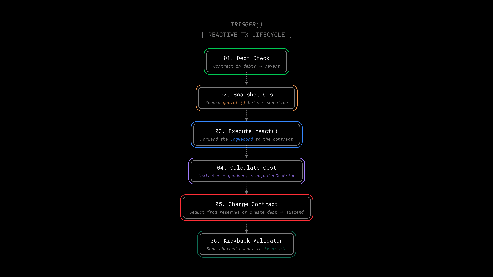
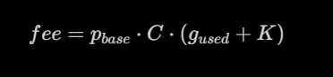

# origins & Destinations & Economy

- **Origin（源链）：**事件发生、事件日志被读取的那条链（即事件来源）。
- **Destination（目标链）：** Reactive Network 投递 callback 交易的那条链（即状态发生变化的链）。


单个 reactive 合约可以订阅来自**多条 origin 链的事件**，也可以向**一条或多条 destination 链发送 callback**。


react() 触发会在Reactive链上留下一条请求，真正的执行发生在 **目标链**（destination），由网络侧的Reactive singer发起，会经过 callback proxy 转发给接收方，中间会异步进行一次跨链

主网和测试网的 callback proxy 合约不可混用，**每条 destination 链上都预置了一个 callback proxy 合约**，docs中标记了这些链上的callback proxy 地址，例如bsc链上

https://bscscan.com/address/0xfc41eE9d3A836b41399BEcce83b06B3e5650f3BB

当destination为reactive链自身时，它的 callback proxy 为系统合约 `0x8888888888888888888888888888888888888888`


所以部署时，如果需要部署到多条链上，一定要在构造函数传对目标链上的callback proxy地址，如果错误，不一定会报错，可能仍正常进入后续监听，但总会revert


## Economy & System Interactions

在 Reactive 上，系统合约向 reactive 合约收取执行 `react()` 的费用；在 destination 链上，callback proxy 向 callback 合约收取投递 callback 的费用。两侧继承同一套记账逻辑，因此下文的各项概念与方法名对两侧都适用。合约需要在两侧都保持有资金，才能维持活动状态。


合约本身拥有balance，即合约可调动的资金；

此外， 系统合约和callback proxy 还会存在Reserves 以及 debt，需满足debt <= 0 以及 存在reverse ，react() 才会正常执行



每笔 reactive 交易都会经过系统合约的 `trigger()` 方法，流程如图所示，所以如果存在debt，欠费合约会停止执行；


reactive 交易与 callback 共用同一套计价公式。费用与它所支付的执行在同一笔交易中扣除，并支付给该交易的发起者：发布 reactive 交易的验证者，或投递 callback 的一方。



回滚的react() 会被Emit为 ReactiveContractReverted， **仍然会计费**。因此每次通知都回滚的合约终将耗尽资金

reactive 交易的 gas 上限最大为 900,000。

Reactive Network 强制要求 callback gas 上限不低于 100,000。低于该阈值的 callback 请求会被忽略


**为合约存入Reverses**

`depositTo()` 用调用者自己的REACT代币为任意合约充值。它会先清偿未付债务，再把剩余部分计入储备金。交易手续费由调用者承担。不需要目标合约配合

`cast send --rpc-url $REACTIVE_RPC --private-key $REACTIVE_PRIVATE_KEY $SYSTEM_CONTRACT_ADDR "depositTo(address)" $REACTIVE_CONTRACT_ADDR --value 1ether`


**直接给合约转账**

随时可以把 REACT 转给合约，但留在合约里的余额本身不会结清任何债务。合约必须把它交给系统合约

当产生费用且储备金为空时，系统合约会调用合约上的 `pay()`，索要其全部未付债务（存在gas预算上限参数 `_maxChargeGas` ）。[AbstractPayer ](https://github.com/Reactive-Network/reactive-lib-omni/blob/master/src/base/AbstractPayer.sol) 实现了这一逻辑，reactive 合约通过 [AbstractReactive ](https://github.com/Reactive-Network/reactive-lib-omni/blob/master/src/base/AbstractReactive.sol) 继承它。标准实现会校验调用者、检查余额，并转出应付金额。


如果不实现 AbstractReactive ，只能手动来触发结算，[AbstractPayer ](https://github.com/Reactive-Network/reactive-lib-omni/blob/master/src/base/AbstractPayer.sol) 把该逻辑实现为 internal 的 `_coverDebt() ` 是否`external`由合约作者决定

如果该操作需要限制，加上 `onlyOwner` 或其他访问控制。公开版本对于服务第三方的合约很有用 —— 任何人都可以为合约充值并使其恢复运行。


### Reactive 合约状态

Reactive 合约的状态可在 [Reactscan ](https://reactscan.net/) 上查看。

- `active` — 合约正常执行
- `inactive` — 必须先结清未付债务

状态会随债务自动变化。当合约债务从零变为正数时，会发出 `BlacklistContract` 事件，网络随即停止为其服务

若合约在与扣费同一笔交易中通过 `pay()` 完成结算，则根本不会被列入黑名单。


**为callback 合约存入reverses**

同样的两条途径也适用于 callback 合约，而 [AbstractCallback ](https://github.com/Reactive-Network/reactive-lib-omni/blob/master/src/base/AbstractCallback.sol) 继承了 [AbstractPayer ](https://github.com/Reactive-Network/reactive-lib-omni/blob/master/src/base/AbstractPayer.sol)，因此 `pay()` 与 `_coverDebt()` 的行为与上文完全一致。处于欠费状态的 callback 合约会停止接收 callback，直到债务结清。


需要注意的是callback 合约要用对应链上的原生代币作为储备，而非REACT


## 查询余额

同样的三种读取在两侧都适用：对 reactive 合约，通过 `REACTIVE_RPC` 调用系统合约；对 callback 合约，通过 `DESTINATION_RPC` 调用 callback proxy

```
cast balance $REACTIVE_CONTRACT_ADDR --rpc-url $REACTIVE_RPC
```


查询 destination 链上某个callback contract 余额

```
cast balance $CALLBACK_CONTRACT_ADDR --rpc-url $DESTINATION_RPC
```


债务：

```
cast call $SYSTEM_CONTRACT_ADDR "debt(address)" $REACTIVE_CONTRACT_ADDR --rpc-url $REACTIVE_RPC | cast to-dec
```

储备金：

```
cast call $SYSTEM_CONTRACT_ADDR "reserves(address)" $REACTIVE_CONTRACT_ADDR --rpc-url $REACTIVE_RPC | cast to-dec
```


### Service Provider

与上面几个读取不同，这一项是在付款方合约自身上调用的，用来确认它需要向哪个合约支付费用。

```
cast call $REACTIVE_CONTRACT_ADDR "_SERVICE_PROVIDER()" --rpc-url $REACTIVE_RPC
```

```
cast call $CALLBACK_CONTRACT_ADDR "_SERVICE_PROVIDER()" --rpc-url $DESTINATION_RPC
```


对 reactive 合约返回系统合约，对 callback 合约返回 callback proxy。


## 查看 Callback

系统合约会记录每一条投递到 destination 链的 callback，以发起请求的 reactive 交易哈希为索引。由于单笔 reactive 交易可以请求多条 callback，该调用返回一个数组：

```
cast call $SYSTEM_CONTRACT_ADDR "getCallbacks(uint256)((uint256,address,uint256,uint256,uint256,bytes)[])" $REACTIVE_TX_HASH --rpc-url $REACTIVE_RPC
```

每条记录包含区块号、发起请求的 reactive 合约、该 callback 在交易中的序号、destination 链 ID、destination 交易哈希，以及 destination 合约返回的错误数据。callback 成功时 `err` 为空。

验证者是在投递完成后才写入这些记录的，因此空数组表示「尚未记录到 callback」，而不是「callback 失败了」。